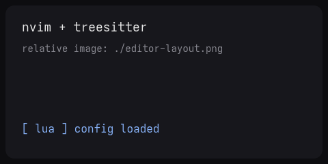

# How I use Neovim

My config is deliberately boring: one `init.lua`, no distribution, a handful of
plugins. Relative images work too — this one sits **next to this file** in
`/posts/`:



## The whole config is ~200 lines

```lua
-- ~/.config/nvim/init.lua
vim.opt.number = true
vim.opt.relativenumber = true
vim.opt.signcolumn = "yes"
vim.opt.expandtab = true

vim.keymap.set("n", "<leader>w", "<cmd>write<cr>", { desc = "save" })
vim.keymap.set("n", "<leader>q", "<cmd>quit<cr>", { desc = "quit" })
```

Lazy-loading plugins means startup stays under 40ms:

```lua
return {
  "nvim-treesitter/nvim-treesitter",
  build = ":TSUpdate",
  event = { "BufReadPost", "BufNewFile" },
}
```

## What I actually use

| plugin      | job                      |
| ----------- | ------------------------ |
| treesitter  | syntax + text objects    |
| telescope   | fuzzy finding everything |
| lspconfig   | completion, diagnostics  |
| gitsigns    | blame at a glance        |

## The rules

1. If a plugin does not save me keystrokes, it goes.
2. Every keymap gets a `desc`, so which-key can explain it.
3. `:wq` is the only exit that matters.

> The best editor config is the one you can explain from memory.
